<div align="center">

# Native Intelligence

**One workspace for all of your work, with an always-on agent that learns it and takes it over.**

[Hosted app](https://dial8.ai) · [Docs](https://dial8.ai/docs) · [Discord](https://discord.gg/sHtYGtkWga) · [Contribute](CONTRIBUTING.md) · [Security](SECURITY.md)

</div>

<br />

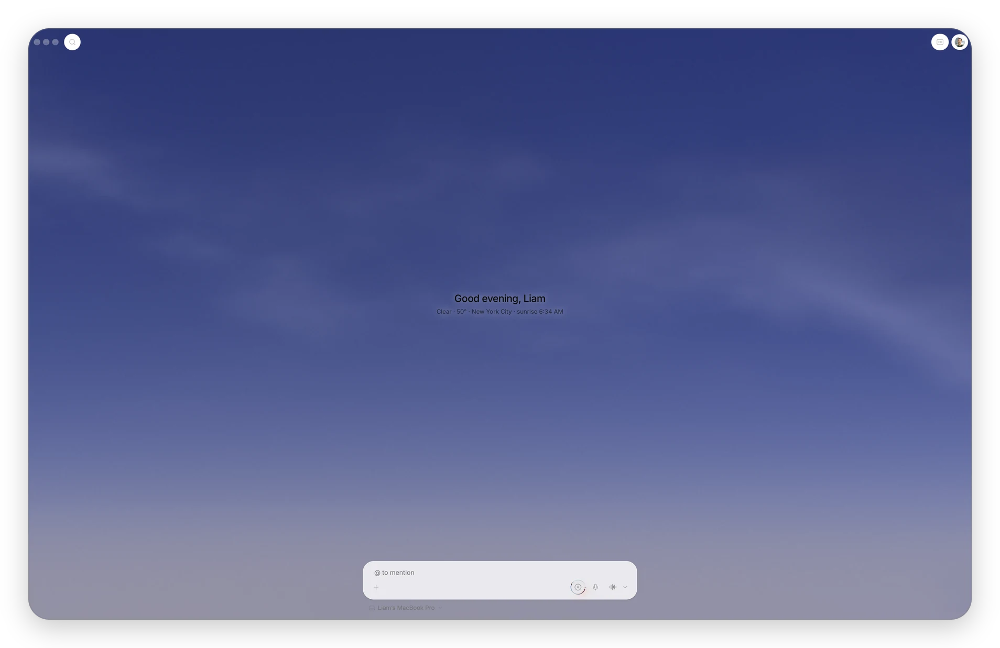

<div align="center"><sub>Every screenshot here is a made-up demo workspace. You can load it into your own install: see <a href="#getting-started">Getting started</a>.</sub></div>

<br />

Native Intelligence puts your email, calendar, meetings, conversations, customers,
prospecting, tasks and documents in one connected workspace, so they stop being
separate apps. You can @mention anything and work with all of it in one place.

At the center is an agent that doesn't wait to be asked. It's always on: it watches the
work happen, learns how you and your team like things done, and takes care of more of
it over time. When it needs you, it texts you. The longer your team uses it, the more it does on its own, and the more your people get to
spend on the work that matters.

<br />

# Why Native Intelligence

Most teams run on a dozen apps that don't know about each other: one for email, one for
the calendar, one for meeting notes, one for chat, one for the CRM, one for prospecting,
one for tasks. People end up as the glue, copying context from one tool to the next.
The AI built into those tools is a chatbot that waits for you to ask it something.

Native Intelligence is both halves of the fix:

1. **One connected workspace.** Every email, meeting, contact, company, task and document
   is a record that links to the others. A meeting knows its attendees, their company,
   the emails before it and the tasks that came out of it.
2. **An agent that works in it, all the time.** Because the agent sees the same
   connected workspace you do, it has the context to do real work: prepare you for a
   meeting, draft the follow-up, update the customer record, chase the open task. It
   learns your preferences as it goes, and the goal is simple: hand it more of your work
   until it runs most of it for you.

<br />

# Model, harness, context

How well an agent works, and how good it is to work with, comes down to three layers:

1. **The model:** the intelligence that does the work.
2. **The harness:** what the model can see and what it can do. Its tools, its memory,
   and the rules around it.
3. **The context:** what it knows about you, your work and your business.

Get one of them wrong and the agent disappoints, however good the other two are.
Native Intelligence brings all three together in one platform:

- **Context.** Your email, calendar, meetings, messages, customers and documents live in
  one workspace, and so does everything you tell the agent along the way: a text asking
  it to remind you about something, or to take care of it. It's all captured, connected
  and remembered.
- **Harness.** More than 250 tools across the workspace, a memory of facts, decisions and
  preferences with where each one came from, skills, automations, and a reviewer that
  holds anything risky for your yes.
- **Models.** The system picks the right model for each job. The main agent, the
  always-on one in charge, orchestrates the work: when it hands something off, it starts
  a helper, picks a model to fit the task (a fast, inexpensive one to draft an email, a
  stronger one for harder work), and gives that helper just the context and skills it
  needs, like an email-writing skill. You can also run it on your own ChatGPT plan.

Models, harnesses and context all keep getting better. Because all three meet in one
place, every improvement compounds: the agent keeps learning your business, or your life,
with all its complexity, until it simply does things for you the way you expect.

<br />

# What's in the workspace

| Part | What it does | Docs |
| --- | --- | --- |
| Email | Gmail and Outlook in one inbox, with replies the agent drafts in your voice and threads linked to the people in them. | [Email &rarr;](https://dial8.ai/docs/features/email) |
| Calendar | Google and Microsoft calendars together, with every meeting linked to its notes, people and follow-ups. | [Calendar &rarr;](https://dial8.ai/docs/features/calendar) |
| Meetings | The desktop, iPhone and Apple Watch apps record and transcribe your meetings, then pull out the actions, decisions and commitments. | [Captures &rarr;](https://dial8.ai/docs/features/captures) |
| Tasks and projects | Tasks with custom workflows and team identifiers (`ENG-42`), grouped into projects, milestones, cycles and initiatives. | [Actions &rarr;](https://dial8.ai/docs/features/actions) |
| Documents | Rich documents you and the agent write together, with @mentions to anything in the workspace. | [Documents &rarr;](https://dial8.ai/docs/features/documents) |
| CRM | Contacts, companies and their whole history, built from your email, calendar and meetings, including who said what on a call. | [CRM &rarr;](https://dial8.ai/docs/features/contacts-and-crm) |
| Prospecting | Find prospects, build lists, and run outreach sequences, with the agent writing each message. | |
| Search and views | Full-text and semantic search across everything, and saved views as lists or boards. | [Search &rarr;](https://dial8.ai/docs/features/search) |
| The agent | Chat, automations, skills, memory and approvals, everywhere you are. More below. | [AI assistant &rarr;](https://dial8.ai/docs/features/ai-assistant) |

<br />

# @mention anything

Every record in the workspace links to the others. @mention a person, company, meeting,
email thread, document or task from a chat, a document or a task, and you, your team and
the agent can all follow the link. Ask the agent about "@Acme" and it reads the emails,
meetings and tasks behind it, not just the name.

<br />

# An agent that's always on

The agent isn't a chat window bolted onto the side. It lives in the workspace, works in
the background, and reaches you wherever you are.

- **Talk to it anywhere.** In the app, on your Mac, on your iPhone or Apple Watch, or by
  plain text message. It texts you back, and when something needs you, it texts you
  first.
- **It does the work, not just the talking.** It drafts and sends email, schedules
  meetings, writes documents, updates records, creates and closes tasks, researches
  companies, and runs a browser of its own for anything on the web.
- **It runs on its own.** Automations run on a schedule or when something happens: a
  meeting ends, an email arrives, a task changes. Skills teach it a process once, so you
  never explain it twice.
- **It learns.** It builds a memory of your workspace from your meetings, documents and
  conversations: facts, decisions, commitments and preferences, each with where it came
  from. Every task it takes on starts from that context.
- **It earns autonomy.** Anything risky, like sending outside your team or deleting
  something, goes through a reviewer and waits for your yes: a tap in the app, or "yes"
  by text. Everything else is done with an undo. As it proves itself, more of your work
  goes through without asking.
- **It works with your tools.** Linear, Jira, Asana, HubSpot, GitHub and more. And it's
  open the other way too: point Claude Code or any MCP client at your workspace.

  ```bash
  claude mcp add --transport http dial8 https://dial8.ai/api/mcp
  ```

- **It can run a business by text.** For an owner on the go, it sends quotes, books
  jobs and even changes the company's website, each one waiting for a "yes" by text.

## Text it, Slack it, share it

Your agent has a phone number you can text, joins your Slack, and you decide who else
can reach it: add the people you trust, or let them ask for access with a code.

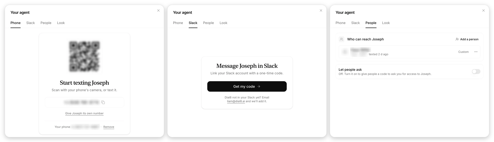

## It shows you, right in the chat

Ask for something and the agent puts the real page in the conversation: a live list or
board, a record, your calendar, a mail thread. It's doing the work, so most of the time a
glance is all you need. When you want to dig in, open it full screen.

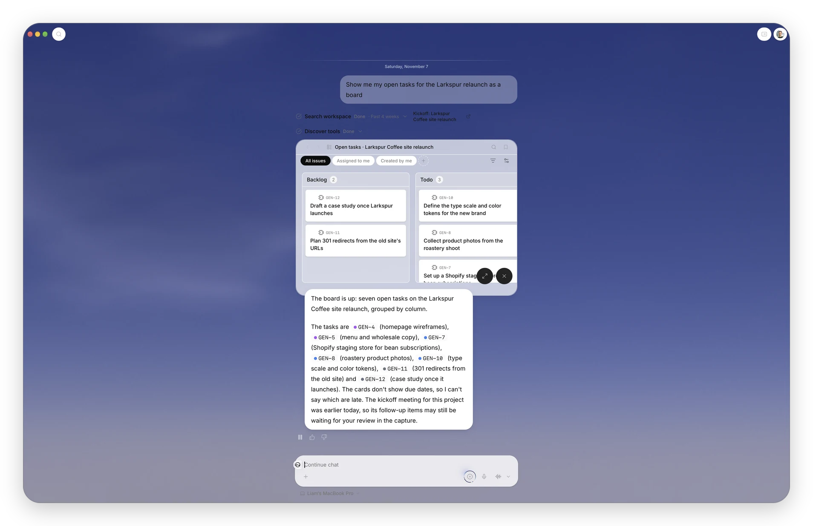

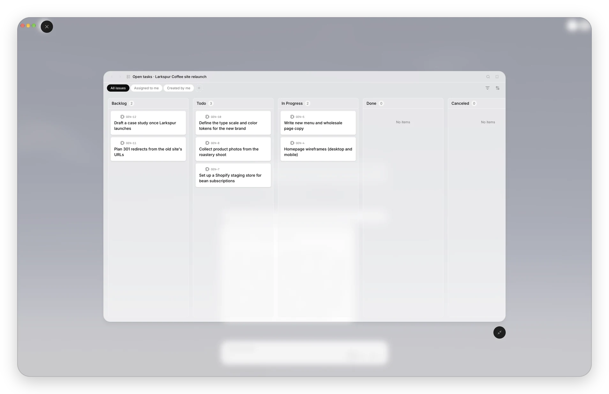

## Its own browser

The agent has a browser of its own, in the cloud. It searches, reads and works through
sites for you while you watch it live, and you can take over whenever you want.

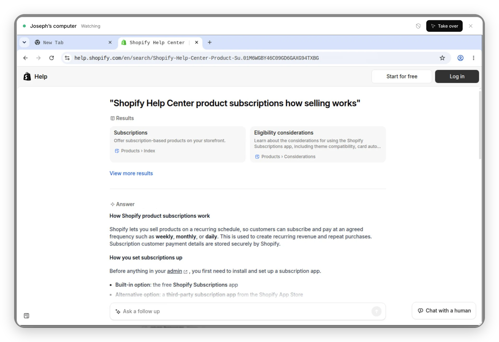

## On your calls

Start a capture and a small call window opens beside your meeting. It puts names to the
voices it knows, keeps the meeting's goal in view, lists what it's picking up as people
talk (one click turns an item into a task), and answers anything you ask while the call
is still going. It's hidden from screen share, so the other side never sees it.
Afterwards you get the notes, the decisions and the tasks, linked to everyone who was
there.

<p align="center">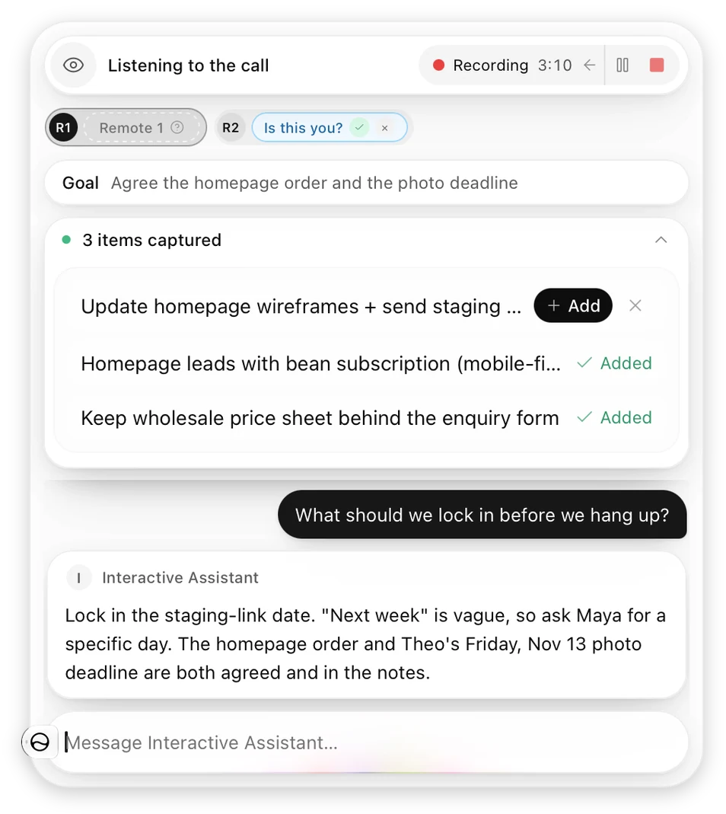</p>

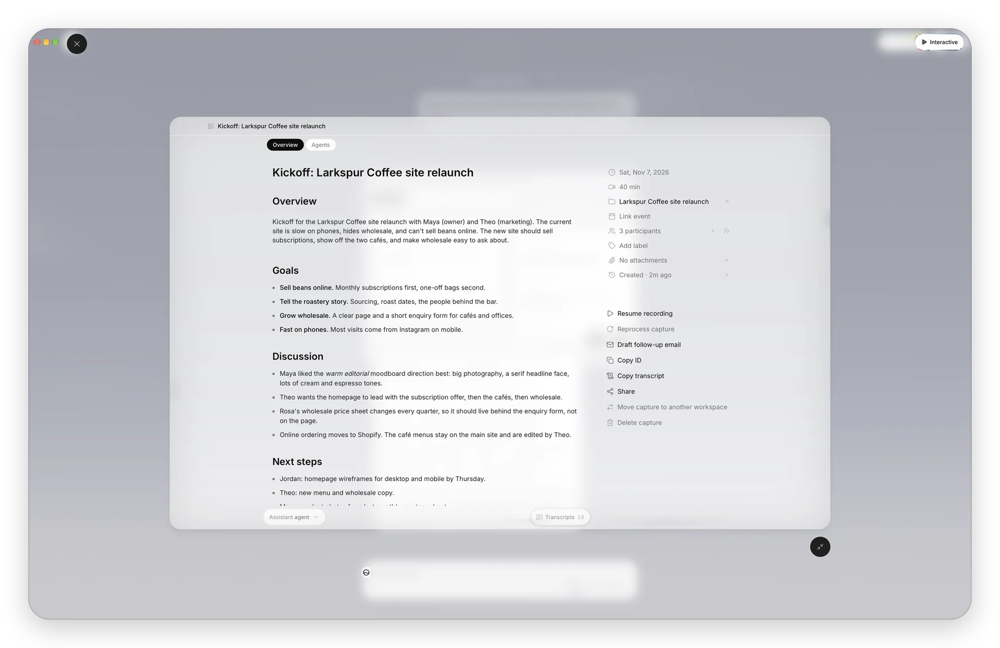

## On your iPhone and Apple Watch

The iPhone app puts your day, your tasks and the agent in your pocket, and records
in-person meetings. On the Apple Watch, one press starts a recording.

<p align="center">
  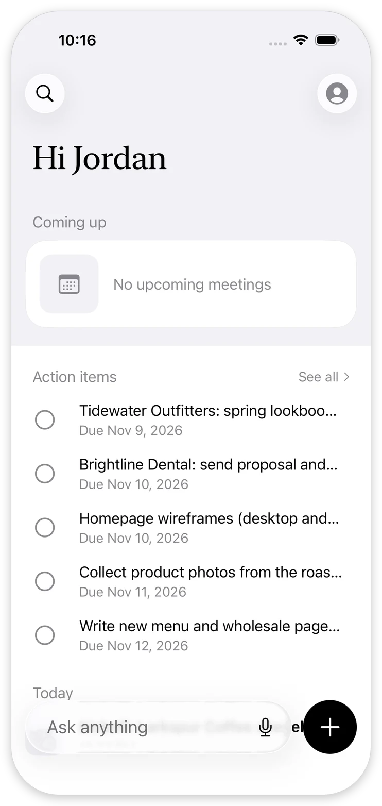
  &nbsp;
  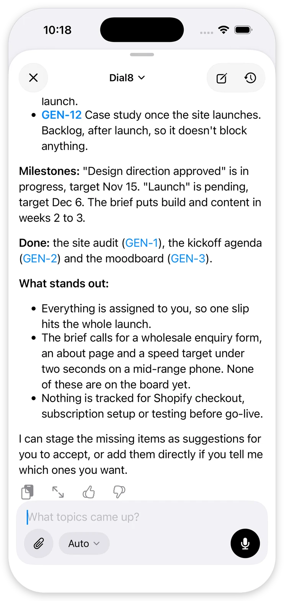
  &nbsp;
  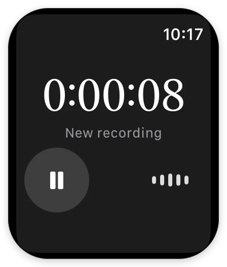
</p>

## What it knows

Everything the agent learns goes into a knowledge graph: facts, decisions, open questions
and who committed to what, each linked to the meeting, document, person or task it came
from. Watch your workspace's context build up as your team works.

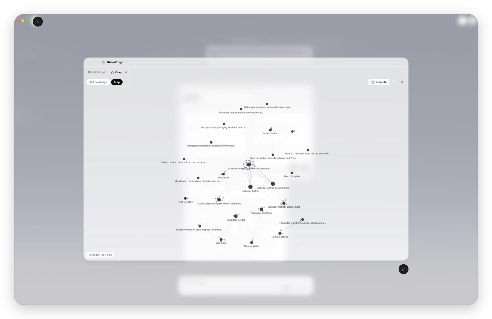

<br />

# Apps

| Folder | What's in it |
| --- | --- |
| [`web/`](web/) | The web app (Next.js): the workspace, its API, the agents, the database migrations (Supabase), the marketing site and the docs. [`web/CLAUDE.md`](web/CLAUDE.md) walks through the code. |
| [`desktop/`](desktop/) | The desktop app (Tauri, Rust) for Mac, with Windows on the way: meeting detection and audio capture, on-device transcription, dictation, read-aloud, and an agent that works on your Mac with your permission. [`desktop/README.md`](desktop/README.md) covers building it. |
| [`ios/`](ios/) | The iPhone and Apple Watch apps (Swift, SwiftUI): meeting capture with on-device transcription, chat with the agent, widgets and a Live Activity, and one-press recording on the watch. [`ios/README.md`](ios/README.md) covers building it. |

<br />

# Roadmap

Where it's going next:

- **Team chat.** Channels and direct messages inside the workspace, with the agent as a
  member of the team, so conversations live next to the work they're about.
- **A full CRM.** Deals with stages, values and pipelines, custom fields, and boards, all
  kept up to date from your conversations instead of by hand.
- **The agent takes your calls.** It calls you when something's urgent, joins a meeting
  for you, speaks for you, and texts you if it needs you.
- **Your customers reach your agent.** Customers who call or text your business number
  talk to your agent, matched to their history.
- **More imports.** Bring customers in from email tools, accounting and payment apps,
  and other CRMs.
- **Windows.** Everything the Mac app does, on Windows.
- **Choose your agent's model.** Pick the model your main agent runs on, while it keeps
  choosing the right model for each helper.
- **Call your agent.** Phone it to ask for something or set a reminder, like texting it
  today.
- **More autonomy.** The agent takes over recurring work as it earns your trust, until
  it runs most of the day-to-day on its own.

<br />

# Getting started

**Use the hosted app.** [Sign up](https://dial8.ai), connect your Gmail or Outlook
account, and the agent starts learning your workspace. The
[quick start](https://dial8.ai/docs/getting-started/quick-start) walks through the rest.

**Run it yourself.** The web app needs Node 24 (`web/.nvmrc`), a Supabase project, and
service keys in `web/.env.local` ([`web/.env.example`](web/.env.example) lists them).
[`web/README.md`](web/README.md) covers the whole setup, including building the database
from empty.

```bash
cd web
npm install
npm run dev     # http://localhost:3000
npm test
```

To look around with made-up data, build a local Supabase (`web/scripts/db-bootstrap.sh`),
put its URL and service-role key in `web/.env.local`, start the dev server, and run
`node node_modules/.bin/tsx scripts/demo-workspace.ts --link` from `web/` (add
`--port=N` if the dev server isn't on 3000). It fills a demo workspace, the one in the
screenshots, and prints a one-time link that signs you in to it.

The desktop app runs against that dev server. Its speech engines are submodules: from
the top of the repo, `GIT_LFS_SKIP_SMUDGE=1 git submodule update --init`.

The iPhone and Apple Watch apps build in Xcode (`ios/Dial8.xcodeproj`, schemes `Dial8` and
`Dial8 Watch`); a Simulator build needs no signing.

<br />

# One repo, older names

Native Intelligence used to be called Dial8, and the hosted app still lives at
[dial8.ai](https://dial8.ai) while it moves. `web/`, `desktop/` and `ios/` started as
three repos, `dial8-website`, `dial8-desktop` and `dial8-ios`. Code, comments and
scripts still use those names in places. Where `desktop/README.md` says
`cd ../dial8-website`, it's `cd ../web` here. The desktop's `scripts/local-agent-bundle.sh`
looks for the website beside it: run it from `desktop/` with `DIAL8_WEB_DIR=../web`.

Comments in the code sometimes point to notes under `web/docs/` (`docs/plans/...` and
the like) that aren't in this repo. They were the team's internal working notes. The
developer guides in `web/docs/` are the ones that ship.

<br />

# Contributing

Contributions are welcome. Read [CONTRIBUTING.md](CONTRIBUTING.md) first: everyone signs
our [Contributor License Agreement](CLA.md) once, on their first pull request. Ideas and
questions are welcome on [Discord](https://discord.gg/sHtYGtkWga).

<br />

# Security

Found a security problem? Don't open an issue: report it privately, as
[SECURITY.md](SECURITY.md) explains.

<br />

# License

Native Intelligence is source-available under the [Business Source License 1.1](LICENSE),
which isn't an open-source license. You can read the code, change it, test it, contribute
to it, and run your own instance of it for your personal use, as long as you don't charge
anyone for it. Running it for a company, or charging for it, takes a commercial license
from us: [get in touch](https://nativeintelligence.dev/contact).

Four years after each version is published, that version moves to the Apache License
2.0.

Some files aren't covered by that license and keep their own:

- Parts of the web app's UI, the marketing site among them, come from
  [Tailwind UI](https://tailwindui.com) and are used under the Tailwind UI license. Using
  them outside Native Intelligence takes a Tailwind UI license of your own.
- The Inter and Noto Serif fonts in `web/packages/ui/fonts/` are under the SIL Open Font
  License, with their license files beside them.
- The desktop's speech engines (submodules) and the other third-party code in `desktop/`
  say what license they're under in their own folders (`UPSTREAM.md` files and
  `licenses/` folders).
- The iOS app's bot avatar bundle (`ios/App/Resources/EveBotAvatar.html`) includes
  bot-avatars and React, under the MIT License: see `ios/THIRD_PARTY_NOTICES.md`.

The license doesn't cover the Native Intelligence name or logo.

<br />

# Star us on GitHub

If Native Intelligence is useful or interesting to you, give the repo a star at the top
of this page. It's how most people find us.
