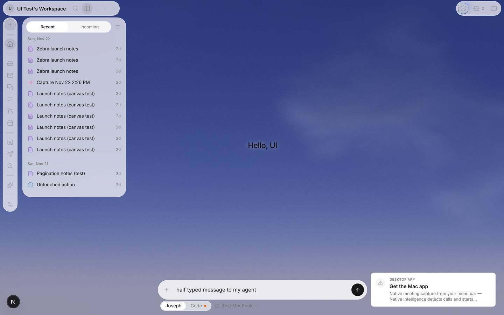
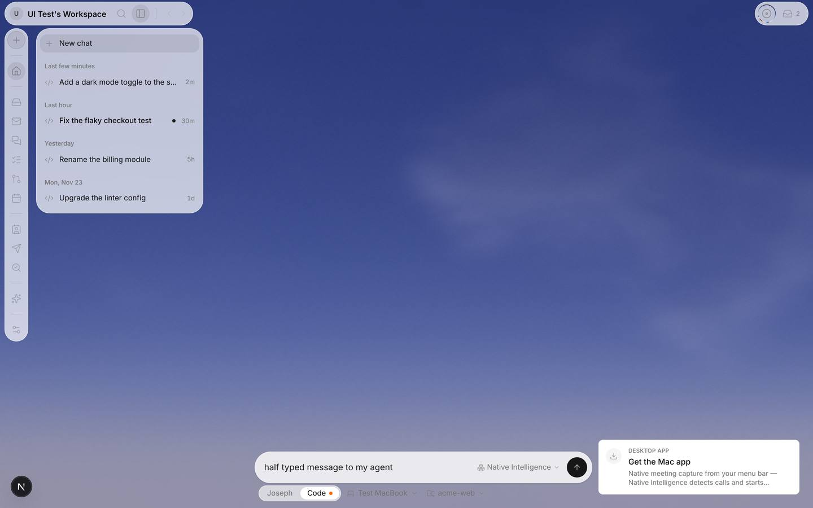
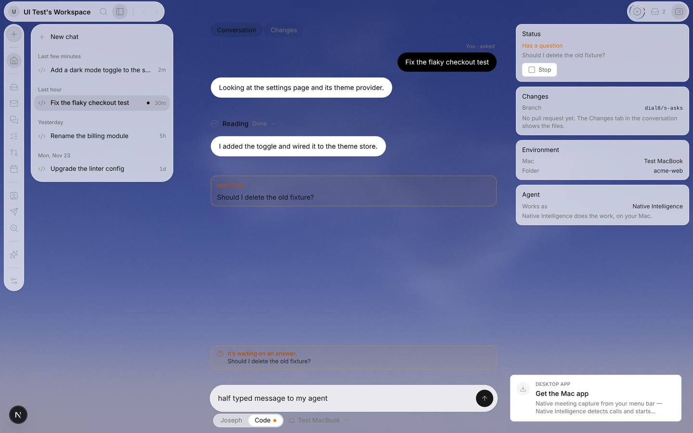
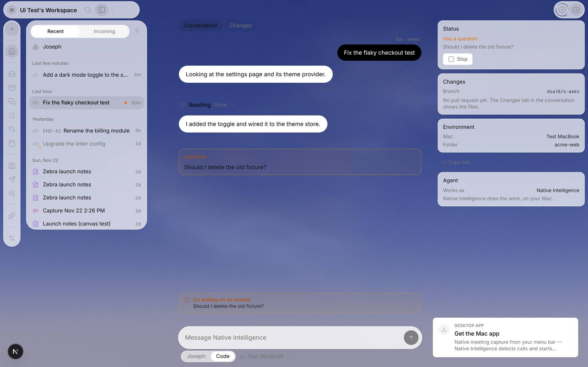
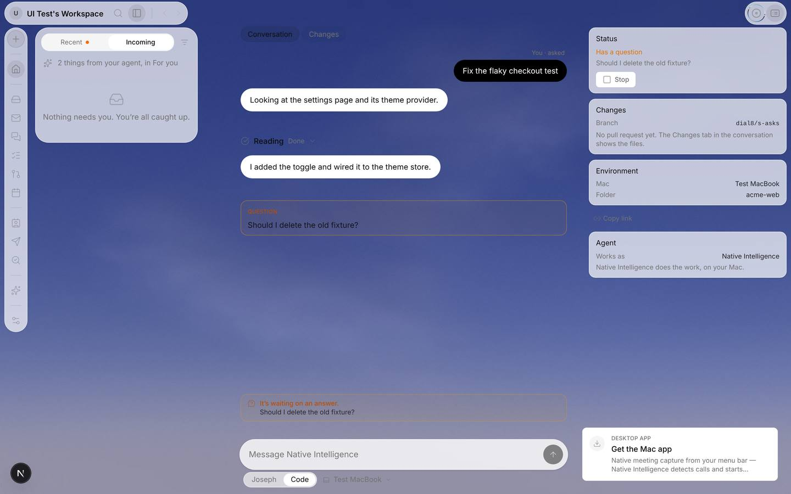
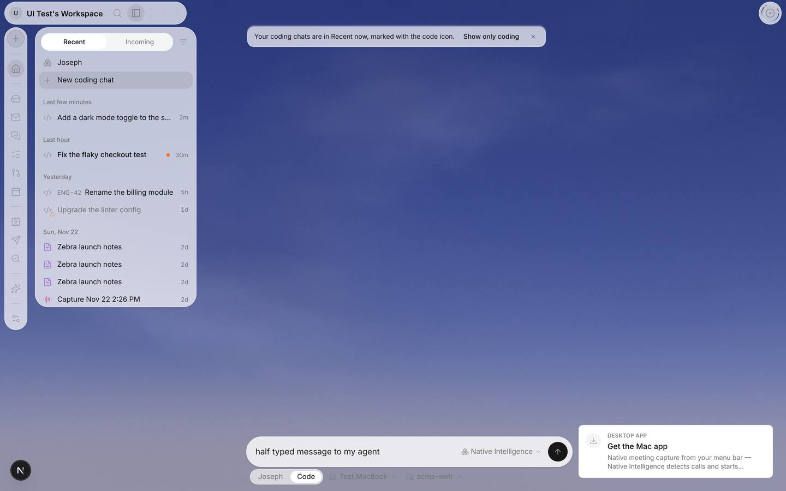

# One Home, one current chat

Branch `claude/one-home`. Approved by the owner on 2026-11-25 (every recommendation in 8 taken),
built phase by phase: see "Built" at the end. No migration. Merged is not live: see
"How production works" in `CLAUDE.md`.

## What the owner said (2026-11-25, lightly cleaned)

> "In the home page right now there's Recent and Incoming, and at the bottom the chat is split
> between your main agent and coding. Coding has its completely different home page, but really the
> only thing that's different is what's shown in the side panels and the chat history. I want to
> unify everything so you only have one homepage view:
> - Your coding chats are mixed in with your recent chats / recent activity, clearly marked with a
>   coding icon.
> - When you click one, the side panels switch to show the coding side panels and controls, and the
>   main chat changes to show that chat.
> - You still have the toggle to start a coding session, but it doesn't show an entirely new view:
>   it just changes your main agent to the coding agent, and you see it as a new chat, the same way
>   the coding view shows it now.
> - We need a way to get back to your main agent. Maybe at the top there's a pinned chat, your main
>   agent's chat, so you can easily go back."

## The design in five lines

1. Home has **one current chat**. It is your agent's chat, a coding chat, or a new coding chat not
   sent yet. Nothing else decides what the middle, the composer and the right panel show.
2. **Recent is the one list.** Your agent is pinned at its top. Coding chats sit among everything
   else by time, with the coding icon and their state. No second list.
3. The composer's **agent | Code** toggle stays, and means "who gets my next message": your agent,
   or a new coding chat. It never swaps the left panel.
4. **Every way into a coding chat calls one function**, and lands in the same place. Today there
   are three places.
5. The Code view's own For you goes away. A coding chat that waits on you is a row with an orange
   dot, and its Review card is in its own right panel.

## Today (local dev server, the test account, coding chats stubbed in the browser)

The test account has no Mac, so it has no Code tab. I stubbed the environment list and four coding
sessions in the browser only (Playwright routes; nothing written anywhere) to look at the view.

| | |
| --- | --- |
| Home, a message half typed |  |
| Code pressed: Recent and Incoming are replaced by the coding chats |  |
| A coding chat picked |  |

What I saw, and what the code says:

- **Pressing Code replaces the whole left panel.** Recent, Incoming, the switch and the filter go;
  "New chat" and the coding chats come (`home-recents.tsx` swaps in `CodeChatsPanel`). This is the
  "completely different home page".
- **The typed words follow the toggle.** "half typed message to my agent" was still in the box on
  Code, and with a coding chat picked. Enter would have sent it to the coding agent. There is one
  box and one `input` state (`chat-panel.tsx`); the draft is saved per workspace, not per chat.
- **The state is in four places:** `side-panel-store.ts` (`codeView`, `codeChat`,
  `codeDetailsOpen`, `codeForYou`, `codeForYouContent`), `code-view-store.ts` (`selected`, `live`),
  the composer's tab kept per conversation (`ni.composer.code.<conversation id>`), and the
  selected chat kept per workspace (`ni:code-view:selected:<workspace id>`). `codeView` is set by a
  composer effect (`composer-code.tsx`), so the view follows the composer.
- **Recent already lists coding chats** (`lib/entities/recents.ts` `codeJobs`, type `code_job`):
  title and time only, no state, under the filter's "Agents" type.
- **A coding job opens in three different places**, depending on where you pressed:

| Way in | Lands on today |
| --- | --- |
| The Code tab's list; a job's line in the agent's thread (with a Mac) | The Code view |
| A Recent row | The Code view, but the composer's tab is not moved (read from the code, not run: `openRecent` sets `codeView` and the chat; the tab stays on the agent, whose effect owns `codeView`) |
| Incoming's row ("needs you", "failed") | The work item's card, full screen, the conversation in a 560px box |
| A desktop notification | The work item's card, or the bot's page |
| A For you card's Open, also inside the Code view's own For you | The work item's card, or the bot's page |
| The right panel's Agents rows | The work item's card, or the bot's page |
| An action's Start on a Mac | A "Mac" tab inside the action's card |
| A job the agent started itself (`start_local_agent`) | Nothing: a tool chip with no Open |
| A link | Nothing: no URL names a coding chat |
| An in-app toast | Nothing: it has no action |

- Resized to a phone's width with a chat open, the details cards drew over the conversation.
  (Resized from a desktop window, not a phone's first load.)

## 1. The model: one current chat

```
[rail] | Recent | Incoming   ≡ | the current chat          | its panel
       | ◉ Joseph              |                           |
       | Last few minutes      |   (your agent's thread,   |  agent: Agents · Plan ·
       | </> Dark mode toggle ◌|    or a coding chat's     |   Context · … | For you
       | ▤  Zebra launch notes |    conversation)          |  coding: Review · Status ·
       | Last hour             |                           |   Changes · Environment…
       | </> Flaky checkout  ● |  [ message box          ] |
       | #  design             |  [Joseph | Code] Mac ▾    |
```

**The current chat is one of three:**

| Current chat | The middle | The composer | The right panel |
| --- | --- | --- | --- |
| **Your agent** (the default) | Its thread | As today on the agent's side | Its sections, or For you, as today |
| **A coding chat** | That chat's conversation (`LocalAgentPanel`, as the Code view draws it) | Messages that chat: held while it works, Send now, Edit, as today | That chat's details: Action, Review, Model, Status and Stop, Changes (branch, commit, pull request), Environment, Agent |
| **A new coding chat** (Code pressed, nothing sent) | Clear, as the Code view is today | The agent picker and the folder picker; the first send starts the chat | Off screen, and no button: nothing to show yet |

**Your agent is pinned.** One row at the top of Recent, above the first time heading, on both
filters and never filtered out: the agent's own icon and name ("Joseph"). It is lit while your
agent is the current chat. While you are elsewhere it shows a quiet pulse while the agent is
replying, and a dot when a reply finished that you have not seen. One press, from anywhere on
Home, is "back to my agent". I considered a fixed bar above the switch: it would push Recent |
Incoming down and repeat on the Incoming side, where it has less to do. A row in the list it
belongs to is quieter and reads as "this is a chat like the others, and it is always here".

**A coding chat is a row like any other**, at the time it last moved. The row:

| State | Icon | Title | Right side |
| --- | --- | --- | --- |
| Working | `</>`, a quiet pulse | plain | time |
| Asks you something | `</>` | medium weight | **orange dot**, time |
| Finished, waits on your review | `</>` | medium weight | **orange dot**, time |
| Done (reviewed, or idle) | `</>` | plain | time |
| Failed, stopped, expired | `</>` with a small warning mark | plain, muted | time |
| Waiting for your Mac | `</>` | plain | "Queued", time |

An action's job keeps its identifier before the title (`ENG-42 Fix the…`), as the Code view's list
shows it. The dot is orange, the Code tab's dot of 11-20, so "a coding chat needs you" keeps its
colour. Screen readers get the state in words ("working", "needs your answer", "waits on your
review", "failed"). The row's tooltip says the folder.

**Opening one** makes it the current chat. The middle shows it, the right panel shows its details
(open by default, its own remembered switch, as today), its row is lit, and the box messages it.
Home stays selected. Nothing else on the left changes.

**What is lit:** the card in front's row, as today. With no card in front, the current chat's row
(the pinned row for your agent). While a card is in front, the current chat's row keeps a thin
marker, so you can see which chat the box under the card belongs to.

## 2. Starting a coding session from the composer

The toggle stays where it is: **[Joseph | Code]**. It says who gets the next message.

- **Code** makes the current chat a **new coding chat**. The middle clears (the owner's 11-16
  "everything clears up"), the agent and folder pickers show in the composer, the right panel goes.
  The left panel does not change. A provisional row, "New coding chat", lit, appears under the
  pinned row so the list says where you are. It goes when you send or leave.
- **The first send** starts the chat. The provisional row becomes the chat's real row, the
  conversation fills the middle, the details open on the right. One compact line still goes in the
  agent's thread for a chat started there (the request is the conversation's, as today).
- **Joseph** (the toggle's other side) goes back to your agent. So does the pinned row. Both are
  always on screen from `md` up; below it see 4.
- While a coding chat is current the toggle shows Code. Pressing **Code again** there starts a new
  one (open question 2).

**Back to my agent, in order of how often it will be used:**

1. The pinned row at the top of Recent.
2. The toggle's agent side.
3. Where Recent is not on screen (the panel closed, a narrow window, a phone): a small
   "‹ Joseph" at the top of the coding conversation, where "‹ Coding chats" is today.
4. The rail's Home button, pressed while Home is already selected and no card is in front
   (open question 6).

**A half-typed message.** A draft belongs to the chat it was typed in.

- Each chat has its own draft: your agent's, each coding chat's, and the new coding chat's.
  Switching swaps the box's words. Coming back, your words are there. Your agent's draft is still
  saved as today (`ni-chat:<workspace id>`); the others are kept for the window's session.
- **One exception, on purpose:** the toggle between your agent and a *new* coding chat carries the
  words across when the other side's box is empty. Nothing has been sent; you are only choosing
  who gets them. ("Fix the flaky checkout test" typed, then you remember it's a Code job.)
- Opening an *existing* coding chat never carries words in. This is the case in the screenshot:
  a note for your agent can no longer be sent to a coding agent by mistake.
- Files, mentions and a skill staged for your agent stay with your agent's draft. The Code side
  keeps today's line saying they are not sent.
- A message held for a working coding chat is handed to the server when you leave that chat, as
  today. It is never lost.

## 3. The left side

**Recommended: one mixed list, plus a "Coding" value in the filter that already exists.**

- Recent holds coding chats among everything else, by time, as the owner asked. That is where
  they already are; they gain their state.
- Recent's filter has a Type for them today, called "Agents". It becomes **"Coding"** (it holds
  nothing else). Type → Coding is the old Code list. Status → Unread is "what needs me", coding
  chats included, since a waiting chat wears the dot.
- The pinned row and the provisional "New coding chat" row are never filtered out.

The other choice, a third side on the switch (Recent | Incoming | Coding), keeps coding as its own
place. That is the thing being removed, and it would take the room of the filter button.

| | One list + filter (recommended) | A third side |
| --- | --- | --- |
| "Mixed in with my recent chats" | Yes | No |
| See only coding chats | Two presses (F, Coding), then kept on this device | One press |
| A busy day of docs and mail buries a coding chat | A waiting one carries the orange dot and sorts by when it last moved; a quiet one can sink | Never buried |
| New things to learn | None | A third place |

**"Needs you" without a second list.** A chat that asks or waits on review moved a moment ago,
so it is near the top, with the dot. Where Recent is not what you are looking at (you are on
Incoming, or the panel is closed), the same orange dot goes on the way back to it: the switch's
Recent side, or the panel's button. Incoming's side already does this with its own dot.

**Incoming** is unchanged in what it lists. A coding chat that asks or fails already raises a
notification ("Your agent" type), so it is there already. What changes is where its row lands: on
the chat (4). Two rows for one thing is right here: Incoming's is the notification (E marks it
done, H holds it), Recent's is the chat. Opening either marks Incoming's read.

**Where there is no panel** (closed, narrow, a phone): the new coding chat's clear middle lists
your recent coding chats under its heading, as the Code view's middle does today, so one can
always be picked.

## 4. Every way in, and every way out

One function, `openCodingChat(sessionId, { from, workspaceId? })`, in the current chat's store.
Everything below calls it. It: switches workspace first when the chat is another one's (as
`openCard` does); puts any full-screen card back in its place (a card would cover the middle);
makes the chat current; opens its details unless the person closed them.

| Way in | Today | With this |
| --- | --- | --- |
| A Recent row | Code view, composer left behind | `openCodingChat` |
| The Code tab's list | Code view | Gone: the rows are Recent's |
| A job's line in the agent's thread | Code view (work item's card with no Mac) | `openCodingChat` |
| Incoming's row, "needs you" or "failed" | Work item's card | `openCodingChat` when the work item is a coding chat |
| A desktop notification | Work item's card or bot's page | The same |
| A For you card's Open, the Agents rows | Work item's card or bot's page | The same |
| The orange dot | The Code tab | The chat's own row (3) |
| A link | None | `/account?code=<session id>` (6) |
| A coding chat the agent started | A tool chip, no Open | The chip gets Open; the chat is a row in Recent, working. **It never takes the middle by itself**: you stay in your agent's chat |
| An in-app toast | No action | Unchanged (it never opened anything; adding an Open is a separate, small ask) |
| An action's Start on a Mac | A "Mac" tab in the action's card | Unchanged: the action's own view of its job. The chat's details keep their Action card, and the action's tab gains "Open chat" (`openCodingChat`), so the two-way link of 11-20 holds |
| The desktop app | The same web code; no event opens a session except the notification | The same |
| A workspace switch | The Code view's chat is dropped, the new workspace's remembered one comes back | The current chat is per workspace: each comes back on its own, or on your agent |
| Reload | The conversation's saved tab, and the workspace's saved chat | The chat you were on, for this window's session. A new window opens on your agent (open question 5) |
| No Mac | No Code tab; jobs open the work item's card | No toggle (nothing to start with). A coding chat that exists still opens as the current chat |

"When the work item is a coding chat": the ways in that hold a work item, not a session, go
through one resolver (the shell's shared ledger row names the session; one read of it otherwise).
Work that is not a coding chat (a bot's research, a cloud coding run) opens its card as today.

**Leaving** is the same from wherever you came: the pinned row, the toggle, "‹ Joseph", another
row. Opening a record from Recent while a coding chat is current puts the record's card in front,
as today; the coding chat stays current under it, and closing the card shows it again.

**Across switches:**

| | Your agent's chat | A coding chat |
| --- | --- | --- |
| Scroll position | Exactly where it was: the thread stays mounted while it is not current (as today), and the width change is anchored as today (`captureChatAnchor`) | Opens at its newest message. Its reader is closed while it is not current, so there is no position to keep |
| A reply in flight | Keeps streaming; the pinned row pulses, then shows the dot | The Mac keeps working; the row shows it |
| The draft | Kept, and saved per workspace as today | Kept for the session |
| The right panel | Open or closed and on the view you left it | Its details, open or closed by their own switch |

## 5. What goes away

| Goes | Because | Replaced by |
| --- | --- | --- |
| The Code tab as a separate home: `CodeChatsPanel`, its swap in `home-recents.tsx`, the "New chat" row | The owner's ask | Recent's rows; the toggle starts a chat |
| `codeView`, `codeChat`, `codeForYou`, `codeForYouContent` in `side-panel-store.ts` | Four flags that follow something else | Read from the current chat |
| `selected` in `code-view-store.ts`, and the composer's effect that sets `codeView` | The view followed the composer | The current chat's store; the composer reads it |
| The tab in `ni.composer.code.<conversation id>` | The toggle is no longer a per-conversation mode | The agent and the folder stay saved there |
| `HIDE_THREAD_CSS` (a `<style>` that hides the thread) | See below | The thread's own wrapper, hidden by React |
| **The Code view's own For you** (owner, 11-20) | It listed "coding work that waits on your review". Those are now rows with the dot, each with its Review card in its own panel. A second For you that exists only while a coding chat is current would be a hidden mode | The rows; Status → Unread |
| The orange dot **on the Code tab** (owner, 11-20) | Pressing Code now starts a new chat, so a dot there would point at the wrong thing | The same orange dot on the chat's row, and on the way back to Recent |
| The work item's card as where a coding chat opens | One place | `openCodingChat` |
| "‹ Coding chats" in the middle | No separate list to go back to | "‹ Joseph" |

**Kept, from the earlier decisions:**

- Your agent's For you never lists coding work (11-20: "a focused view for important things").
- The coding chat's turn summary shows only in the right panel while it is open (11-20).
- "The main chat and the agents chats are showing at the same time" must never happen (11-16).
  The reason for the `<style>` was that a rule in the app's stylesheet could be a stale copy. The
  new rule is not a stylesheet rule at all: the thread's wrapper takes `inert` and
  `visibility: hidden` from the same render that mounts the coding conversation, so the two change
  in one commit. The thread stays mounted, as today, for its scroll and its stream. A test holds
  it: whenever the coding stage is in the document, the thread's wrapper is inert and hidden.
- Every coding agent is treated the same (11-16).

**The first time, for someone used to the Code tab.** They press Code expecting their list. They
get the new chat, and the list is where it always was on the left, now with their coding chats in
it. The clear middle says, once per device until dismissed: "Your coding chats are in Recent now,
marked `</>`." with **Show only coding** (it sets the filter's Type). Their last chats are also
right there in Recent, at the times they worked on them.

## 6. The architecture

**One store: `chat/current-chat-store.ts`.** A plain module, as the two it replaces are.

```ts
type CurrentChat =
  | { kind: 'agent' }
  | { kind: 'code'; sessionId: string }
  | { kind: 'code-new' }

getCurrentChat(): CurrentChat             // stable between changes (useSyncExternalStore)
setCurrentChat(next, { from })            // the one writer
openCodingChat(sessionId, { from, workspaceId? })
backToAgent({ from })
syncCurrentChatWorkspace()                // as syncCodeViewWorkspace: per workspace
draftOf(chat) / setDraft(chat, text)      // the box's words, per chat
```

- `code-view-store.ts` keeps only what the conversation's reader publishes (`live`, `error`,
  `attempt`) for the chat that is current, and is renamed `code-chat-live.ts`.
- `side-panel-store.ts` loses the four flags. `rightShown`, `shownView`, `toggleRightPanel` and
  `toggleSidePanelView` take the current chat's kind as an argument (they are pure; the callers
  read it). `codeDetailsOpen` stays, with its key.
- **The side panels choose from the current chat**, in `side-panels.tsx`: `agent` → the sections
  or For you; `code` → `CodeChatSections`; `code-new` → nothing. The top bar's buttons
  (`side-panel-toggles.tsx`) read the same: no For you button on a coding chat, the details'
  button there.
- **The composer** (`composer-code.tsx`) reads the current chat instead of owning a tab. `active`
  is `kind !== 'agent'`. `setTab('code')` is `setCurrentChat({ kind: 'code-new' })`.
- **The middle** (`code-chat-stage.tsx`) mounts the conversation for `code`, the clear state for
  `code-new`, and tells the thread's wrapper to hide (a prop from `chat-panel.tsx`, not CSS).
- **Recent** (`recents-model.ts`, `home-recents.tsx`): the pinned row, and a coding row's state
  from a pure `codeRowState(...)`. `code-chats-model.ts`'s fields move onto the row.
  `lib/entities/recents.ts` `codeJobs` also selects the status, the last signal, the ledger row
  and the action, and orders by when the chat last moved (today it orders by creation, so an old
  chat that just asked something can fall outside the 50 read).

**The URL.** One deep link, read once like the others (`main-chat-context.tsx` `deepLinkCard`):
`/account?code=<session id>`, with `&workspace=` as the others take. It calls `openCodingChat`.
The address bar does not follow the current chat as you switch: no card in the app does, and a
reload is covered by the session's memory. A coding chat's details get "Copy link".

**Migration.** No database migration. On the device: `ni:code-view:selected:<workspace id>` and
the `tab` inside `ni.composer.code.<conversation id>` stop being read. They are left in place
(harmless; an older build in another tab still reads them) and nothing is rewritten. The first
load after the change opens on your agent.

**Performance.**

- Only the current coding chat has a live reader, as today (one session, one reader). A chat that
  is not current costs nothing: no channel, no timer.
- A row's state comes from Recent's read (when the panel comes on screen, on the window's focus,
  when a card in front closes, when a chat starts or is messaged here), and from the shell's
  shared ledger rows in between, which the For you cards already listen to. So a working row
  stops pulsing when its turn ends without a new channel and without a timer.
- Your agent's thread stays mounted and streaming while a coding chat is current, as today.
- Coming back to a coding chat reads it again (one page). Keeping the last few mounted would hold
  their channels open; not worth it until someone asks.
- The chat panel still reads one string for the open coding chat (`openCodeChatKey`), so a
  streaming chat does not re-render it.

## 7. Phasing

Each step is shippable alone and leaves nothing half-switched.

1. **The store, behind today's screen.** `current-chat-store.ts` becomes the one source;
   `codeView` and `codeChat` are derived from it; the composer reads it. The screen is the same.
   Fixes the Recent-row case where the composer stays behind. Tests: the state model.
2. **One left panel.** The pinned row, coding rows with state, the "Coding" filter value, the
   provisional row. `CodeChatsPanel` and its swap go. Code pressed no longer changes the left.
   The first-time line.
3. **Every way in.** `openCodingChat` and the resolver wired into Incoming, the desktop
   notification, For you cards, the Agents rows, the job's line, the agent's tool chip, the
   action's "Open chat", `?code=`. "‹ Joseph". Tests: one per row of the table in 4, in and out.
4. **The draft per chat**, with the toggle's one exception.
5. **Clean-up.** The Code view's For you and the Code tab's dot go, the dot moves to the rows and
   the way back; the four flags and `HIDE_THREAD_CSS` are deleted; `code-view-store.ts` renamed.

Steps 2 and 5 are the ones the owner will see as "the change"; 1, 3 and 4 can be reviewed as
plumbing and behaviour fixes.

## 8. Open questions for the owner, each with a recommendation

1. **The Code view's own For you and the Code tab's orange dot (your 11-20 asks) go.** Coding
   work that waits on you becomes an orange dot on the chat's own row in Recent (and on the way
   back to Recent when it is off screen); your agent's For you still never lists coding work.
   **Recommended: yes.** The alternative keeps a For you that only shows while a coding chat is
   open, which is a second view again.
2. **Pressing Code while a coding chat is open.** **Recommended: it starts a new chat**, always:
   the toggle starts, Recent resumes. The alternative: Code goes back to the coding chat you were
   last on, and a "New" button starts one.
3. **One mixed list with "Coding" in the filter, or a third side on the switch?**
   **Recommended: the mixed list**, and the filter's "Agents" type renamed "Coding".
4. **A half-typed message.** **Recommended: each chat keeps its own draft; the only carry is
   between your agent and a new coding chat when the other box is empty.** The alternative is
   today's: one box, the words follow you everywhere.
5. **After a reload.** **Recommended: you come back to the chat you were on in that window; a new
   window, or the desktop app started again, opens on your agent.** The alternative: always your
   agent.
6. **The rail's Home button, pressed while already on Home with nothing in front.**
   **Recommended: it goes to your agent**, so Home's own button is a way home. The alternative: it
   does nothing new, as today.
7. **A coding chat the agent starts for you.** **Recommended: it shows as a working row in Recent
   and an Open on the agent's tool chip; it never takes the middle by itself.**
8. **The pinned row's label.** **Recommended: the agent's own name and icon ("Joseph"), nothing
   else.** The alternative: "Joseph · your agent", or a pin mark.
9. **Cloud coding runs** (not on a Mac) are not chats today; they open their work item's card.
   **Recommended: leave them out of this change.** Making them chats is its own piece of work.
10. **Phones.** There is no Recent below `md`. **Recommended for this change: "‹ Joseph" at the
    top of a coding chat, and your recent coding chats listed in a new coding chat's clear
    middle.** A real Recent on phones is the separate screen offered on 11-24.

## Tests (when built)

- `chat/__tests__/current-chat-store.test.ts`: the three kinds; per workspace; the session's
  memory; `openCodingChat` from another workspace; a chat that is gone falls back to your agent.
- The draft per chat, and the toggle's carry (both directions, and never into an existing chat).
- One test per way in and out from the table in 4.
- `side-panel-store.test.ts`, `side-panels.test.tsx`: the panel's content and buttons from the
  current chat's kind.
- `page-panel.test.tsx`, `recents-model.test.ts`: the pinned row (never filtered, lit, its dot),
  each row state, the "Coding" type, the provisional row, the orange dot on the way back.
- The 11-16 regression: with the coding stage in the document, the thread's wrapper is inert and
  hidden, in the same render.
- The existing Code view tests are rewritten against the store, none skipped.

## Built

**Phase 1: the store, behind today's screen.** `chat/current-chat-store.ts` is the one writer of
the current chat (`openCodingChat`, `newCodingChat`, `showCoding`, `backToAgent`). The composer's
tab, Recent's coding row, the coding chats' list and the job's line all go through it;
`side-panel-store.ts`'s `codeView` and `codeChat` are its mirror. The screen is as it was:
`current-chat-store.test.ts` pins the panels' choice for each state the Code view had. Fixed on
the way: a coding chat opened from Recent now moves the composer's tab with it
(`open-recent-code.test.ts`, and "the tab and the current chat are one thing" in
`composer-code.test.tsx`).

**Phase 2: one left panel.** Pressing Code no longer changes the left panel.

- **Recent** (`page-panel/home-recents.tsx`): the agent pinned first (`PinnedAgentRow`: its name
  and icon, lit while current, a pulse while it replies and a dot for a reply finished unseen
  while you are on another chat); "New coding chat" under it while that is the current chat; a
  coding chat's row with the coding icon and its state (`recents-model.ts` `codeRowState`:
  working, queued, asks, review, done, failed), the action's identifier first. The orange dot is
  on a row that asks or waits on your review. With nothing in front the current chat's row is
  lit; under a card it keeps a thin mark.
- **The state comes with the row** (`lib/entities/recents.ts` `codeJobs`: the session's status,
  last signal, ledger row and action, ordered by when it last moved). No second read, no
  migration. The current chat's row follows its conversation's own reader between reads; a
  review waiting comes from the shell's shared source.
- **The filter's "Agents" type is "Coding"** (the key is unchanged, so a saved filter holds).
- **The toggle** is the current chat: Code always starts a new coding chat (decision 2), the
  agent's side goes back. A conversation's saved `tab` is no longer read as a mode.
- **A reload** comes back on the chat this window was on (`sessionStorage`,
  `ni:current-chat:<workspace id>`; decision 5), per workspace. The Code view's device memory
  (`ni:code-view:selected:…`) is no longer read.
- **The first-time line** in a new coding chat's clear middle, once per device, with **Show only
  coding** (`code-chat-stage.tsx`). Where Recent is not on screen the coding chats are listed
  there, as before.
- **Every decision is one value** in `chat/one-home-decisions.ts`.
- Gone: `CodeChatsPanel` and its swap, the list's "New chat" row.
- Not yet (phase 5): the tab's own dot and the Code view's For you are still there; the dot on
  the way back to Recent.

Found by the tests on the way: with the pinned row lit, J/K would have opened every row it
passed. A step flips only with a card in front, as before.

**Phase 3: every way in, and every way out.** `openCodingChat(sessionId, { from, workspaceId? })`
is the one way in (`chat/current-chat-store.ts`).

| Way in | Built in | Test |
| --- | --- | --- |
| A work item pressed anywhere: a desktop notification, a For you card's Open, the Agents rows | `lib/bots/open-teammate.ts` `goToItem` (`on: 'chat'`), the nav's `openCodingChat` (`hooks/use-open-teammate.ts`) | `ways-into-a-coding-chat.test.tsx` |
| A settled item nothing on screen holds | the light read names its chat (`/api/account/activity/[id]?light=1` → `local_agent_session_id`; `lib/bots/item-lookup.ts`) | the same, and the route's test |
| Incoming's row | `components/inbox/inbox-store.ts` `inboxOpen` | the same |
| A coding chat the agent started | "Open chat" on its chip (`components/prompt-kit/tool.tsx` `startedCodingChat`); it never takes the middle | the same |
| A link | `/account?code=<session id>` (`chat/coding-chat-link.ts`, read at boot in `main-chat-context.tsx`); "Copy link" in the chat's details | the same |
| Another workspace's chat | the store asks for the switch (`SWITCH_FOR_CODING_CHAT_EVENT`), the chat opens when the workspace arrives | the same |
| An action's Mac tab | "Open chat" above its conversation (`action-detail-panel.tsx`) | (one button; not rendered in a test: the panel has no test harness for its Mac tab) |
| No Mac | the middle is mounted for every person; the box is the open chat's (`composer-code.tsx`) | `composer-code.test.tsx` |

Ways out: "‹ Joseph" where Recent is not on screen (`code-chat-stage.tsx`); the rail's Home
pressed on Home with nothing in front (`rail/app-rail.tsx` `pressHome`, decision 6).

Left as they were, on purpose: an in-app toast has no action; work that is not a coding chat (a
bot's research, a cloud coding run) opens its page or card; a caller that passes its own
`openHere` still shows the item in place.

**Phase 4: a draft per chat.** `chat/chat-drafts.ts` (the rules) and `chat/use-chat-drafts.ts`
(the home thread's box): each chat keeps its own words for the window's session, per workspace.
The one carry is between the agent and a new coding chat when the other box is empty. A new
chat's first send leaves no draft behind (`draftSent`). The chat's saved copy keeps the agent's
own draft whatever chat is on screen (`agentDraft`). The bug seen in the browser, a note for the
agent sitting in the box under a coding chat, is pinned by `chat-drafts.test.tsx`.

**Phase 5: clean-up.**

- **The four flags are gone** from `side-panel-store.ts` (`codeView`, `codeChat`, `codeForYou`,
  `codeForYouContent`). The store holds one value, `chatKind`, the current chat's kind, handed to
  it by `current-chat-store.ts` (`setPanelChatKind`). `rightShown`, `shownView` and the toggles
  read it. `codeDetailsOpen` and its key stay.
- **The Code view's own For you is gone** (decision 1). While a coding chat is the current one
  the panel is its details and the top bar has no For you button. The agent's For you still
  never lists coding work.
- **The orange dot** is off the Code tab (`CODE_TAB_DOT` in `one-home-decisions.ts` puts it
  back). It is on the chat's row, and, while Recent is off screen, on the switch's Recent side
  and on the panel's button (`page-panel/coding-attention.ts`).
- **`HIDE_THREAD_CSS` is gone.** The thread's own element (its messages, or its empty state) is
  `inert` with `visibility: hidden` and `opacity: 0` from the same render that draws the coding
  chat (`chat/thread-hidden.ts`, `chat-panel.tsx`). `code-chat-stage.test.tsx` holds the 11-16
  rule: through every move between the three kinds of chat, the thread is out exactly when a
  coding chat is drawn.
- `code-view-store.ts` is `code-chat-live.ts` (what the conversation's reader holds; the
  functions kept their names).

**Where the build differs from the design above**

- The store's state is `chat` plus the coding chat it holds, with `pressCode`, `newCodingChat`,
  `openCodingChat`, `backToAgent` and `setCurrentChat` as its writers (the design sketched
  `setCurrentChat` and `draftOf`); the drafts are their own module (`chat-drafts.ts`).
- The side panel store keeps the current chat's kind as one value it is told, in place of
  reading the other store: the two would otherwise import each other.
- A coding row's tooltip says its state, not its folder (the folder is not in Recent's read).
- A row's state between reads follows the conversation's reader for the current chat and the
  shared source for a waiting review. A chat that is not current and starts asking is seen at
  Recent's next read (focus, a card closing, a chat started or messaged here), as the old list.
- "Copy link" is a small button under the details' cards.

**Looked at in a local browser** (2026-11-25, the test account; it has no Mac, so the
environment and four coding sessions were stubbed in the browser only, nothing written):

| | |
| --- | --- |
| A coding chat opened from Recent: its row lit, its details on the right, the box its own (the note typed for the agent is not in it) |  |
| On Incoming with a coding chat waiting: the orange dot on the way back to Recent |  |
| Code pressed: Recent stays, "New coding chat" under the pinned agent, the words carried across |  |

Also checked there: the pinned row goes back and the agent's draft is in the box again; a reload
returns to the chat; no For you button and no dot on the Code tab; no injected style, and the
thread carries its hidden props while a coding chat is up. At a phone's width, a new coding
chat's middle lists the coding chats (their dot orange too), and the first-time line is left
out there, since it would point at a Recent that is not on screen.

**Not proven**: a real coding chat's send and stream after these changes (no Mac on the test
account), a notification's click in the desktop app, a second workspace, a real phone.
